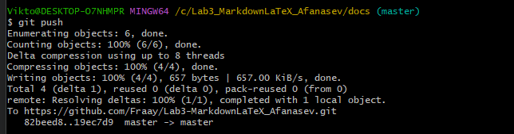

# Работа с **Markdown**-разметкой и базовое использование LaTeX
## Содержание

1. О проекте

2. Структура проекта

3. Mardown-элементы

4. LaTeX в Markdown

5. Скриншоты

6. Задачи

7. Примечания

***
### О проекте

Данный репозиторий создан в рамках выполнения **лабораторной работы №3** по теме «Работа с Markdown-разметкой и базовое использование LaTeX в документации проекта».

В ходе работы были изучены и применены на практике основные возможности языка разметки **Markdown**: заголовки, списки, таблицы, ссылки, изображения, блоки кода, цитаты, чекбоксы, сноски, alert-блоки GitHub и встроенный HTML.

Также были рассмотрены базовые конструкции **LaTeX** для оформления математических формул: inline-формулы, блочные формулы, дроби, корни, степени, индексы, греческие буквы, суммы и матрицы.
***
### Структура проекта

```bash
Lab3_MarkdownLaTeX_Afanasev/
├── docs/
|   ├── advancedMarkdownLab3_Afanasev.md
|   ├── codeQuotesLab3_Afanasev.md  
|   ├── formattingLab3_Afanasev.md   
|   ├── headersLab3_Afanasev.md   
|   ├── latexLab3_Afanasev.md   
|   ├── linksImagesLab3_Afanasev.md   
|   ├── listsLab3_Afanasev.md      
|   ├── ReadmePushLab3_Afanasev.md   
|   ├── separatorsLab3_Afanasev.md   
|   ├── tablesLab3_Afanasev.md 
├── img/
|   ├── advancedMarkdownCommitLab3_Afanasev.png   
|   ├── codeCommitLab3_Afanasev.png
|   ├── commitStructureLab3_Afanasev.png
|   ├── formattingCommitLab3_Afanasev.png
|   ├── gitPushLab3_Afanasev.png
|   ├── linksCommitLab3_Afanasev.png
|   ├── listsCommitLab3_Afanasev.png   
|   ├── separatorsCommitLab3_Afanasev.png
|   ├── tablesCommitLab3_Afanasev.png
├── latex/
├── README.md
```
***

### Markdown-элементы
#### 1. Заголовки

В Markdown заголовки создаются с помощью символа #. Количество # определяет уровень заголовка.

# H1 - Заголовок первого уровня
## H2 - Заголовок второго уровня
### H3 - Заголовок третьего уровня
***
#### 2. Форматирование текста
* **Полужирный текст** - `**текст**`
* *Курсив* - `*текст*` 
* ***Полужирный курсив*** - `***текст***`
* ~~Зачеркнутый текст~~ - `~~текст~~`
* `Код в линию` - `код`
* Блок кода на языке программирования
```python
print("Hello world!")
```
***
#### 3. Списки
**Маркированный список**
* Первый пункт
* Второй пункт
* Третий пункт

**Нумерованный список**
1. Первый пункт
2. Второй пункт
3. Третий Пункт

**Вложенный список**
1. Основной пункт
    1.1 Подпункт
    1.2 Подпункт
2 Второй основной пунк
    2.1 Подпункт
    2.2 Подпункт
***
#### Цитата
> Это пример цитаты в Markdown
>> Вложенная цитата второго уровня
***
#### 5. Блок кода
```python
def hello(name):
    print(f"Hello, {name}")
hello("Markdown")
```
```bash
git add .
git commit -m "Initial commit"
git push
```
***
#### 6. Таблица
| Фунция | Команда Git | Описание |
|--------|-------------|----------|
| Создание репозитория | `git init` | Инициализация репозитория |
| Просмотр состояния | `git status` | Показывает изменённые файлы |
| Отправка на GitHub | `git push` | Загружает коммиты на сервер |
***
#### 7. Ссылки
* [Github](https://github.com/)
* [Официальный сайт Mardown](https://www.markdownguide.org/)
* [Ссылка на раздел списки](#3-списки)
*** 
#### 8. Изображение 

***

### LaTeX в Markdown

#### Inline-формула
Площадь круга вычисляется по формуле $S = \pi r^2$
Формула Эйнштейна: $ E = mc^2$

#### Блочная формула

$$
\int_0^\infty e^{-x^2} dx = \frac{\sqrt{\pi}}{2}
$$

#### Дополнительные конструкции
* Дробь: $\frac{a}{b}$
* Корень: $\sqrt{x}$, $\sqrt{y^4}$
*  Груческие буквы: 
* $\alpha, \beta, \gamma, \lambda$
* Степень: $x^2, x^{10}$
* Индекс: $a_i, a_{i+1}$
* Матрица: 
$$
\begin{pmatrix}
1 & 2 \\
3 & 4
\end{pmatrix}
$$  

### Скриншоты

| Скриншот | Описание |
|----------|----------|
| `gitPushLab3_Afanasev.png` | Привязка репозитория и push |
| `commitStructureLab3_Afanasev.png` | Коммит структуры проекта |
| `headersCommitLab3_Afanasev.png` | Коммит заголовков |
| `separatorsCommitLab3_Afanasev.png` | Коммит горизонтальных линий |
| `formattingCommitLab3_Afanasev.png` | Коммит форматирования текста |
| `listsCommitLab3_Afanasev.png` | Коммит списков |
| `linksCommitLab3_Afanasev.png` | Коммит ссылок и изображений |
| `codeCommitLab3_Afanasev.png` | Коммит блоков кода и цитат |
| `tablesCommitLab3_Afanasev.png` | Коммит таблиц |
| `advancedMarkdownCommitLab3_Afanasev.png` | Коммит расширенных возможностей |
| `latexCommitLab3_Afanasev.png` | ОпиКоммит LaTeX-формулсание |
| `readmeFinalPushLab3_Afanasev.png` | Финальный коммит README |
***

<p style="color: #2c3e50; font-weight: bold;">Лабораторная работа №3 — Markdown и LaTeX</p>